# Cedarline Trading

An Odoo, n8n, and Power BI lab for a fictional building-materials distributor. The lab follows a box of porcelain tiles from supplier pricing and purchasing through receipt, sale, delivery, invoicing, and payment. It also tests reading and writing Odoo records through the JSON-2 API.

The Power BI report tracks sales and purchases before VAT and stock by location. Its three pages were checked against the Odoo sample transactions and stock counts. A daily n8n workflow exports the three source files to a synced OneDrive folder ahead of the scheduled Power BI refresh.

[Odoo walkthrough](#odoo-walkthrough) · [Accounting and valuation](#accounting-and-stock-valuation) · [Stock and replenishment](#stock-locations-and-replenishment) · [n8n workflows](#n8n-integration) · [Power BI](#power-bi-reporting)

## Odoo walkthrough

### Company, customer, and product setup

**Odoo workspace.** Cedarline Trading runs in an Odoo Online trial. The app launcher is the starting point for opening the sales, purchasing, inventory, and accounting apps used below.

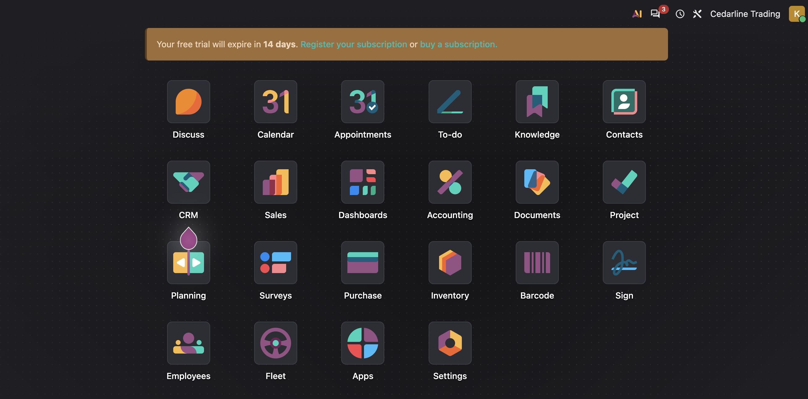

**Accounting localization.** The Accounting settings show Lebanon as the fiscal localization and default taxes of **11%** for sales and purchases. Prices are entered before tax, and the company uses Lebanese pounds (**LBP**).

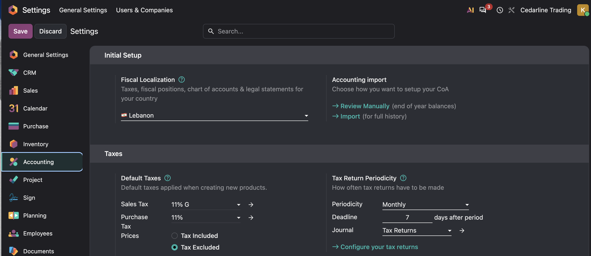

**Customer record.** Juniper Ridge Contracting is the company Cedarline quotes and invoices. The same customer record connects the opportunity, sales order, and invoice.

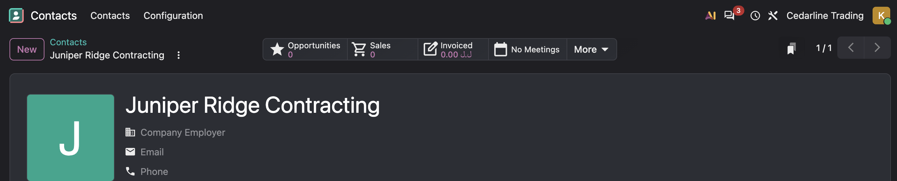

**Tracked product.** One unit of **Porcelain Floor Tiles (Box)** represents one box. The product sells for **1,000,000 LBP per box** before VAT. Inventory tracking records movements, and the **Delivered quantities** invoicing policy makes boxes eligible for invoicing after delivery.

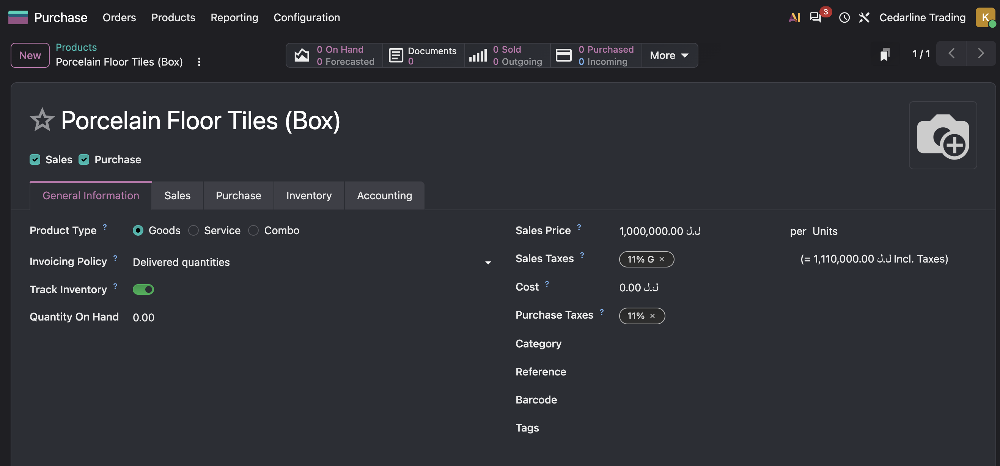

**Supplier pricing.** The product’s Purchase tab lists Bekaa Tile Supply at **700,000 LBP per box** with a one-day lead time. The **On received quantities** bill control setting ties supplier billing to the boxes that arrive.

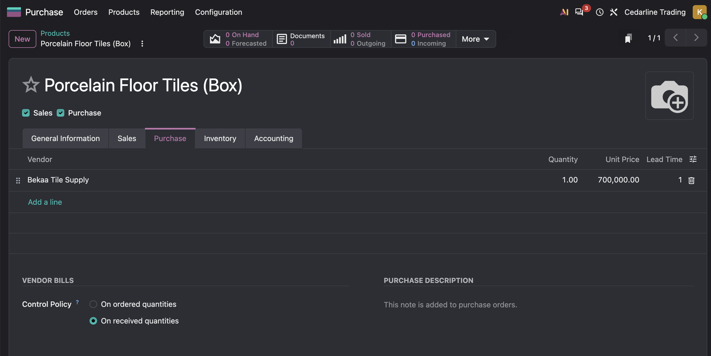

### From opportunity to confirmed sale

**Qualified opportunity.** Juniper requests five boxes. Cedarline records **5,000,000 LBP** in expected revenue before VAT and moves the opportunity to **Qualified** once the item and quantity are clear.

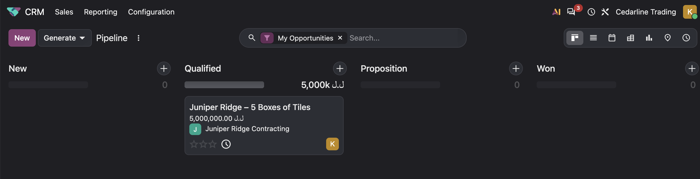

**Sales order S00001.** After Juniper accepts the quotation, Cedarline confirms it. The order records five boxes, **5,000,000 LBP** before tax, and **550,000 LBP** in VAT. The **Delivery** button opens the warehouse document created for the order.

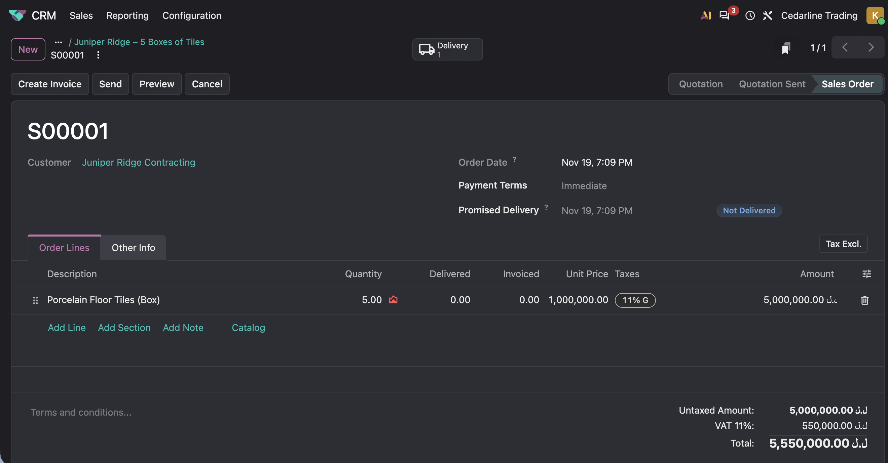

### Purchase and receive stock

**Purchase order P00001.** Cedarline confirms an order for **20 boxes** from Bekaa Tile Supply. Odoo uses the saved supplier price of **700,000 LBP per box**. The order totals **15,540,000 LBP**, including **1,540,000 LBP** in VAT.

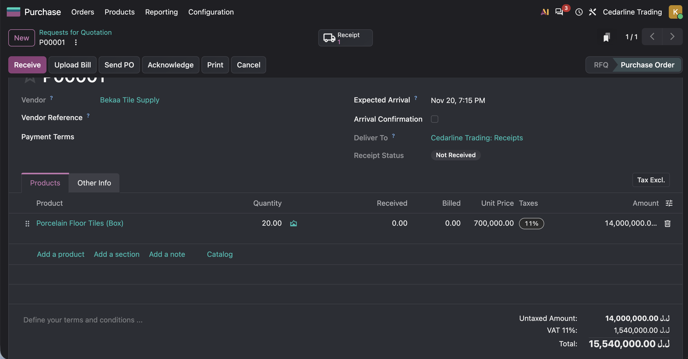

**Warehouse receipt WH/IN/00001.** The warehouse validates the receipt for all 20 boxes. The **Done** status records their arrival into stock and makes stock available for Juniper’s waiting delivery.

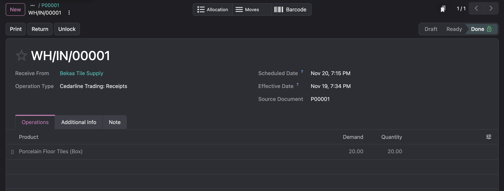

### Deliver, invoice, and collect payment

**Customer delivery WH/OUT/00001.** The warehouse validates the dispatch of five boxes against **S00001**. The transfer shows **Done**, leaving 15 boxes on hand. Cedarline can now invoice the five delivered boxes.

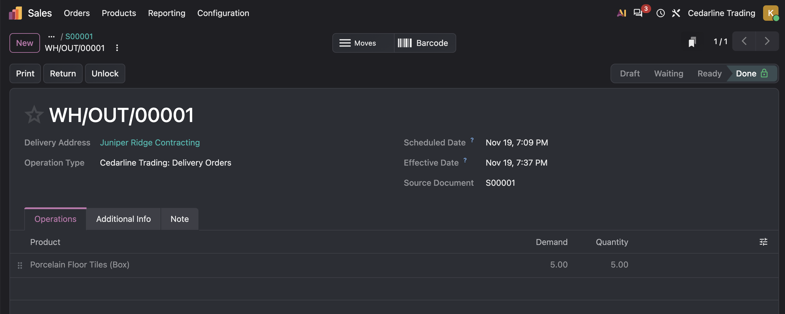

**Posted customer invoice.** The journal for **INV/2026/00001** debits receivables by **5,550,000 LBP** and credits **5,000,000 LBP** in sales and **550,000 LBP** in VAT. The receivable is what Juniper owes when the invoice is posted.

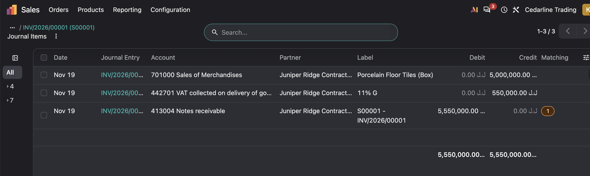

**Customer payment.** Cedarline registers a simulated bank payment for **5,550,000 LBP**. Matching it to the deposit in Odoo changes the invoice from **In Payment** to **Paid**.

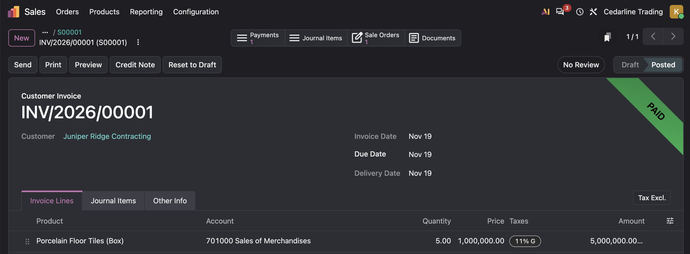

### Accounting and stock valuation

**Posted supplier bill.** The journal for **BILL/2026/11/0001** debits **14,000,000 LBP** in purchases and **1,540,000 LBP** in deductible VAT. It credits **15,540,000 LBP** to payables, the amount owed to Bekaa for the full batch.

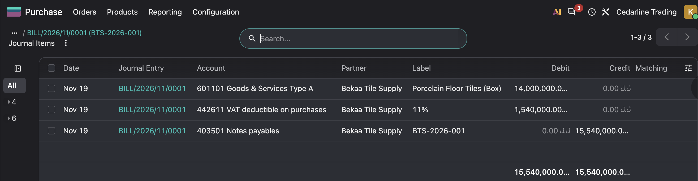

**Supplier payment.** Cedarline registers a simulated outgoing payment and matches it to the withdrawal in Odoo. The vendor bill shows **Paid** and retains its link to **P00001**.

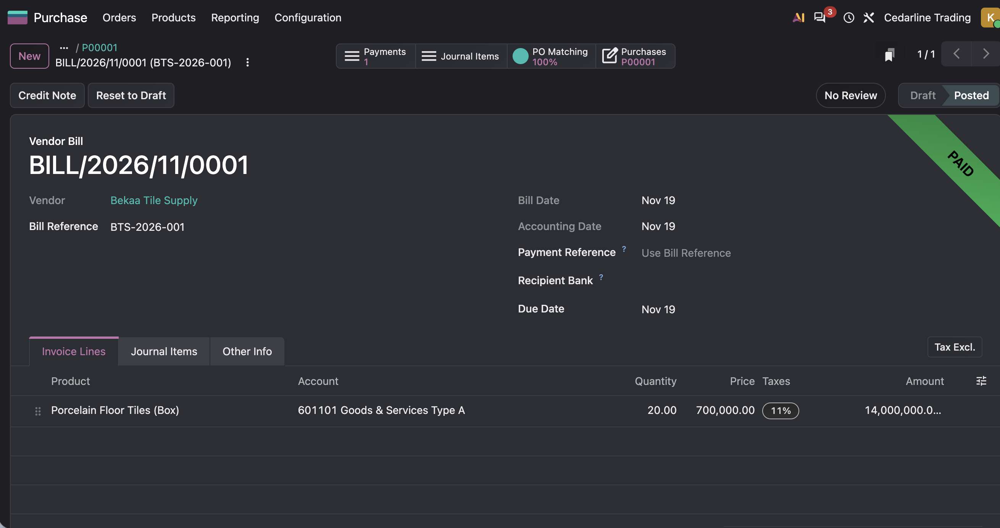

**Value of the remaining stock.** After the first delivery, the Stock report shows **15 boxes** on hand. With the standard cost set to **700,000 LBP per box**, the remaining stock is worth **10,500,000 LBP**.

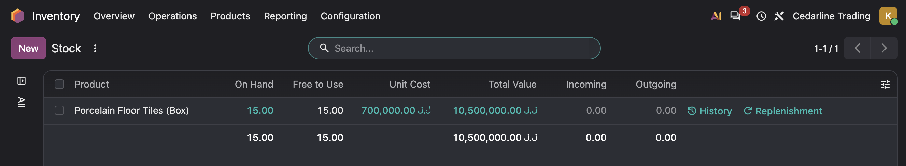

**Stock closing entry.** Cedarline uses periodic inventory valuation. The posted entry **STJ/2026/11/0001** increases inventory by **10,500,000 LBP** and offsets the same amount against purchase expense. The remaining expense is **3,500,000 LBP**, the cost of the five boxes sold.

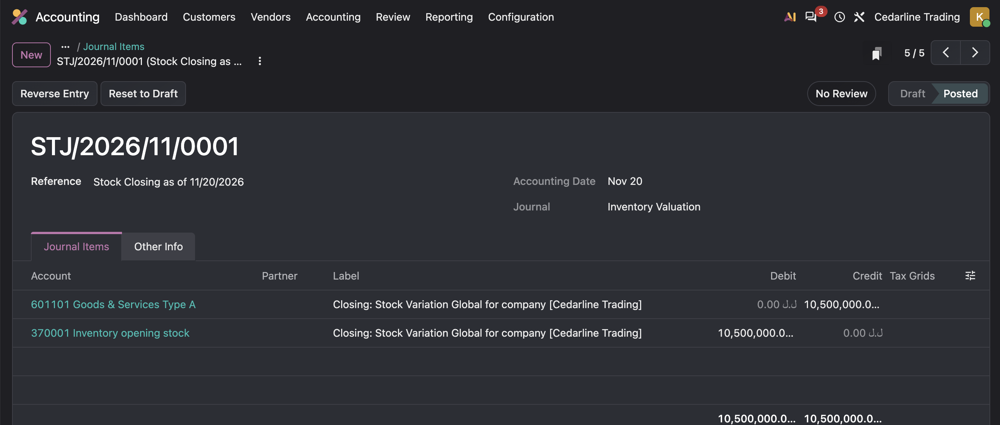

**Profit and Loss.** The report after the closing entry shows **5,000,000 LBP** in revenue, **3,500,000 LBP** in operating expenses, and **1,500,000 LBP** in net profit. This snapshot covers the first sale.

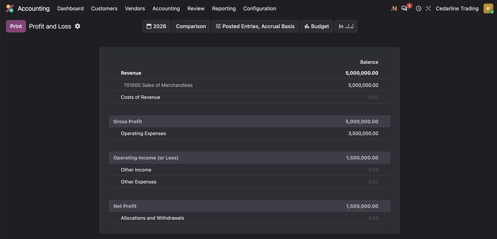

### Discounts and payment terms

**Second quotation S00002.** Juniper orders five more boxes. A **10% line discount** reduces the untaxed amount to **4,500,000 LBP**. With **495,000 LBP** in VAT, the new total is **4,995,000 LBP**.

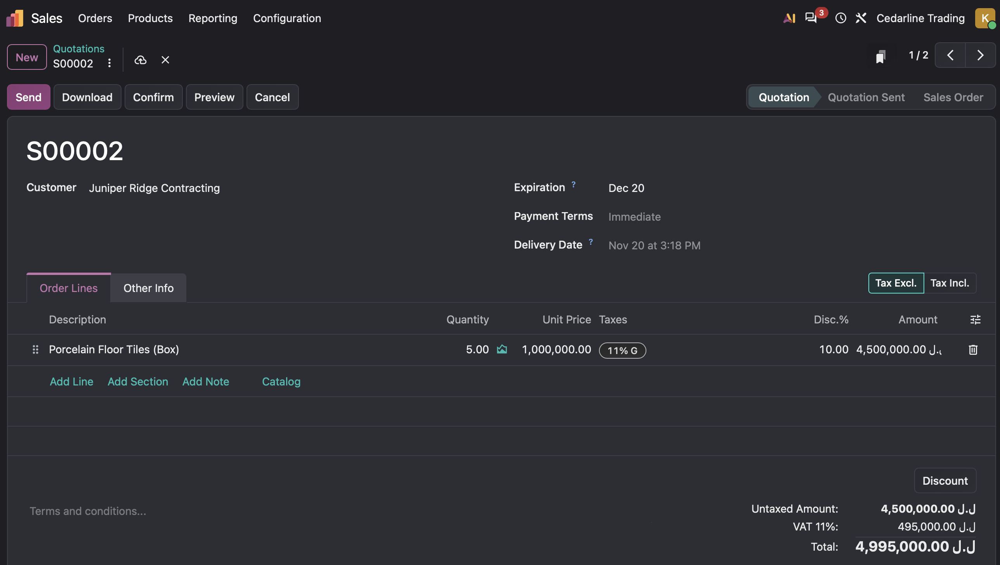

**Two installment dates.** Cedarline applies **30% Now, Balance 60 Days**. After the order is confirmed, delivered, and invoiced, the journal for **INV/2026/00002** shows **1,498,500 LBP** due on **20 November 2026** and **3,496,500 LBP** due on **19 January 2027**.

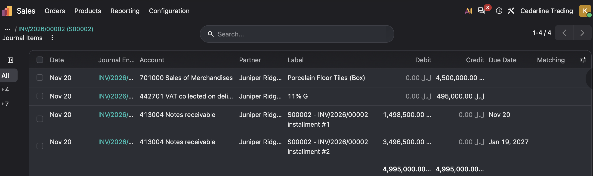

### Stock locations and replenishment

**Stock by location.** Ten boxes remain after the second sale. Internal transfer **WH/INT/00001** moves three to the showroom. The location report shows **7** in main storage and **3** in the showroom.

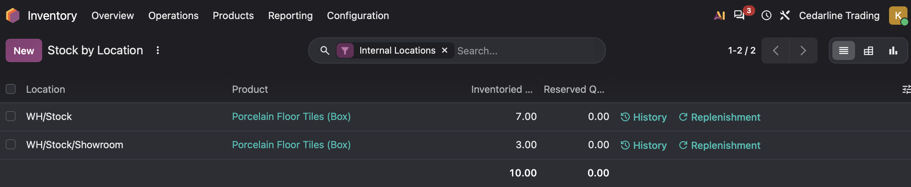

**Manual reordering rule.** The rule uses a minimum of **12 boxes** and a maximum of **20**. Forecast stock is **10**, so Odoo suggests buying **10** to bring it back to the maximum.

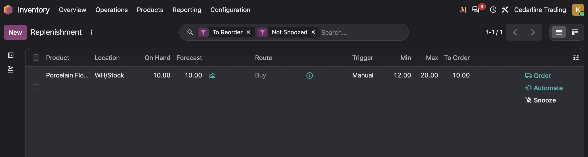

**Draft request for quotation P00002.** Clicking **Order** on the suggestion creates an RFQ for **10 boxes** from Bekaa Tile Supply at **700,000 LBP per box**. The screenshot shows the draft ready for the buyer’s review.

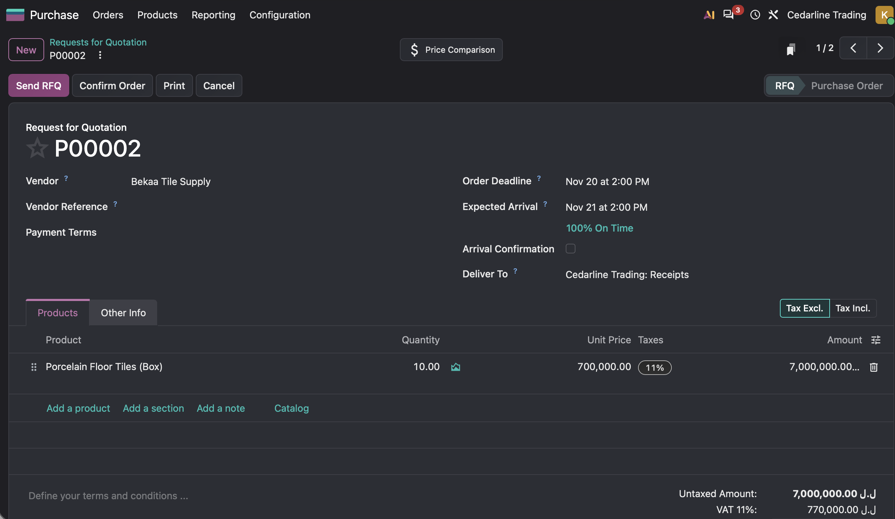

### Studio, user access, Project, and Fleet

**Delivery instructions.** Cedarline uses Odoo Studio to add a multiline **Delivery Instructions** field to Contacts. Juniper’s record shows the saved instructions to use Gate B and call the site office on arrival.

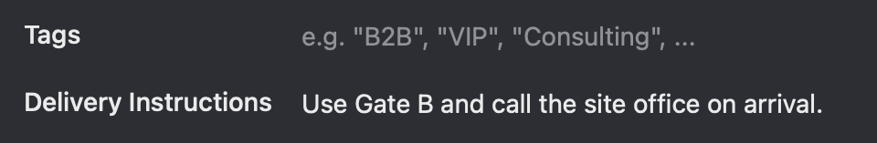

**Warehouse permissions.** The test account has the **Inventory User** role and view access to products. Sales, Purchase, Accounting, and Bank access are disabled for this user.

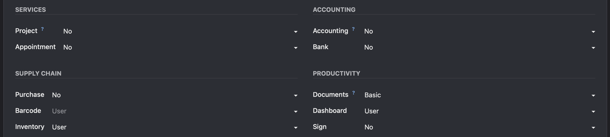

**Permission check.** Signed in as Warehouse Staff, Cedarline opens the completed internal transfer **WH/INT/00001** and verifies its three-box movement from **WH/Stock** to **WH/Stock/Showroom**.

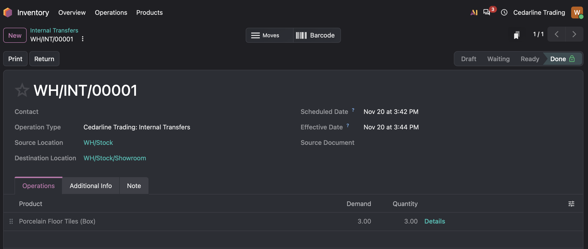

**Showroom project.** The **Label the tile shelves** task moves through the Showroom Setup board. The green check on the task in **Done** shows that Cedarline closed it.

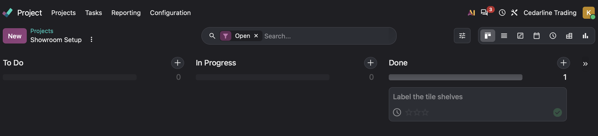

**Delivery van.** Cedarline registers the sample Ford Transit **DEMO-VAN-01** in Fleet and saves its first odometer reading of **24,500 km**.

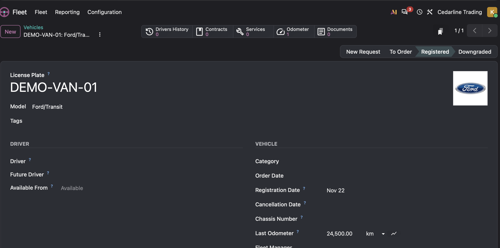

## n8n integration

The workflows send JSON to named Odoo methods. Odoo uses HTTP `POST` for the method calls. The method controls whether the call reads or writes data. The two API demos run manually, and the Power BI export uses a daily Schedule Trigger. [Odoo JSON-2 documentation](https://www.odoo.com/documentation/19.0/developer/reference/external_api.html)

| Workflow | Odoo method | Verified result |
| --- | --- | --- |
| [Read and filter sales orders](workflows/read-and-filter-sales-orders.json) | `sale.order/search_read` | Read the confirmed orders and kept **S00001** at **5,550,000 LBP** using a **5,000,000 LBP** threshold. **S00002** at **4,995,000 LBP** fell below the threshold. |
| [Create a test contact](workflows/create-test-contact.json) | `res.partner/create` | Created a sample contact and returned its Odoo record ID, **14**. |
| [Export Power BI source CSVs](workflows/export-power-bi-source-csvs.json) | `sale.order/search_read`, `purchase.order/search_read`, `stock.quant/search_read` | Wrote two sales orders, one purchase order, and two inventory rows to three CSVs. All three files synced to OneDrive. |

**Write verification in Odoo.** After the contact workflow returned **14**, the Contacts list showed **Cedarline n8n Test Contact** with the sample email submitted in the request. This confirms the new record was saved in Odoo.


### Run the workflows

1. Use an n8n instance and an Odoo database with JSON-2 API access. Generate an Odoo API key for an account with the permissions needed for the workflow.
2. In the n8n workflow editor, choose **Import from File** and import one of the JSON exports above. [n8n import guide](https://docs.n8n.io/build/manage-workflows/export-and-import)
3. In each HTTP Request node, replace `https://odoo.example.com` with your Odoo instance URL. Keep the method path and select a **Bearer Auth** credential containing your Odoo API key.
4. Execute the workflow manually and check the output against your Odoo records. The sales workflow reads up to ten confirmed orders and compares totals including tax. The contact workflow creates a new record each time, so use it with sample data.

## Repository layout

```text
screenshots/
  odoo/                  Screenshots from the Cedarline Odoo lab
  power-bi/              Report pages and completed refresh history
workflows/
  create-test-contact.json
  export-power-bi-source-csvs.json
  read-and-filter-sales-orders.json
```

## Power BI reporting

**Cedarline Trading Report** uses one semantic model built in the Power BI service. Power Query imports three Odoo CSV exports from OneDrive for work or school. Each report page uses its own source table, with a summary card, a detail table, and an on-page slicer.

| Page | Source and what each row represents | Report filter | Check against Odoo |
| --- | --- | --- | --- |
| **Sales** | `cedarline-sales-orders.csv`, one row per confirmed order | Order Reference | **9,500,000 LBP before VAT** across `S00001` and `S00002`. Selecting `S00002` shows **4,500,000 LBP**. |
| **Purchasing** | `cedarline-purchase-orders.csv`, one row per confirmed purchase order | Vendor | **14,000,000 LBP before VAT** for `P00001` from Bekaa Tile Supply. The detail table shows **Fully Received** and **Fully Billed**. |
| **Inventory** | `cedarline-inventory-by-location.csv`, one row per product and internal location in this sample | Location | **10 boxes on hand, 0 reserved, and 10 available**. The warehouse has **7** and the showroom has **3**. Selecting the showroom filters the card and detail table to **3**. |

### Report screenshots

**Sales**

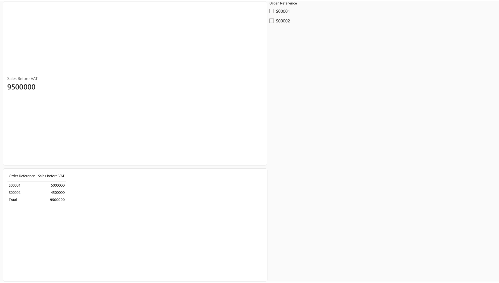

**Purchasing**

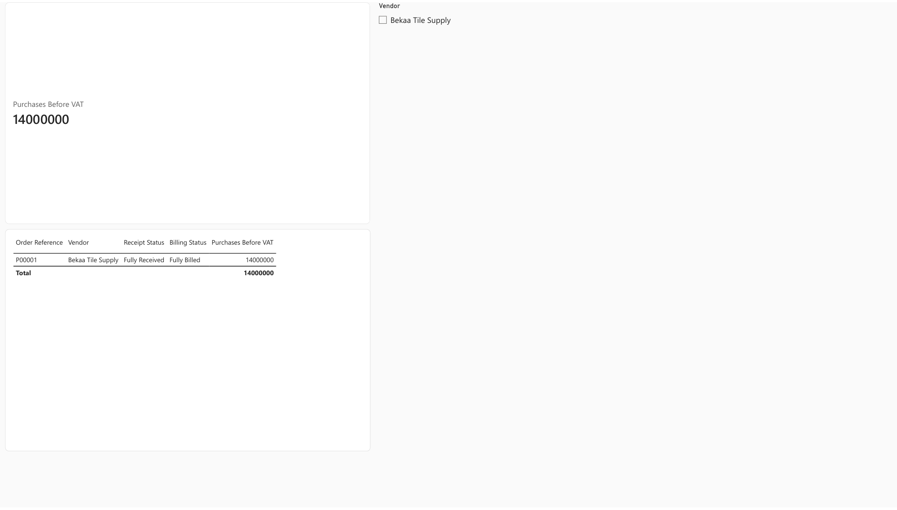

**Inventory**

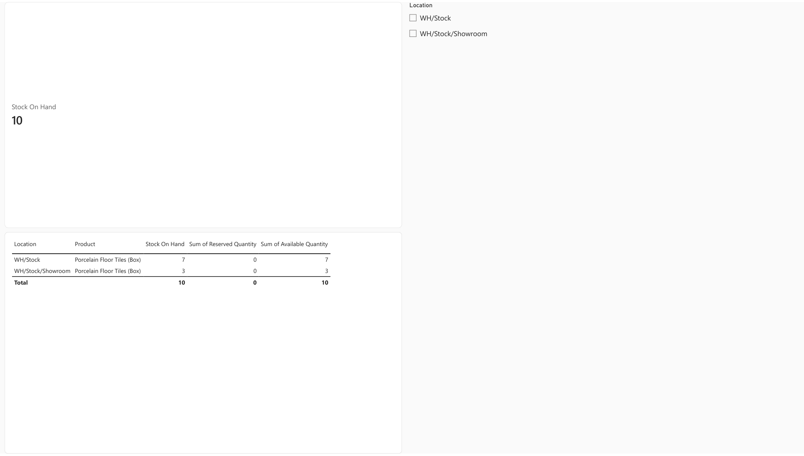

### Rebuild the model and report

1. From Odoo, export confirmed sales orders, confirmed purchase orders, and the Inventory **Locations** report as CSV. Both order exports need **Order Reference** and **Untaxed Amount**. The purchase export also needs **Vendor**, **Receipt Status**, and **Billing Status**. Include **Location**, **Product**, **Inventoried Quantity**, **Reserved Quantity**, and **Available Quantity** on the inventory export.
2. In Power BI, import the sales CSV into a semantic model named **Cedarline Trading Model**. Open the model in **Editing** mode and add the other CSVs through **Home → Get data → Text/CSV**. Check the preview for UTF-8 and comma separation. Keep references and labels as text, order dates as date/time, and the sample amounts and box counts numeric. [Add data to a semantic model](https://learn.microsoft.com/en-us/power-bi/transform-model/service-edit-data-models#get-data)
3. Add each DAX measure to its source table. Create a report with the three pages above, use each measure in its page's card and detail table, and add the matching slicer. Compare the card and table values with the Odoo totals.

```dax
Sales Before VAT = SUM('cedarline-sales-orders'[Untaxed Amount])
Purchases Before VAT = SUM('cedarline-purchase-orders'[Untaxed Amount])
Stock On Hand = SUM('cedarline-inventory-by-location'[Inventoried Quantity])
```

### Refresh the report from n8n

1. Import the [Power BI CSV workflow](workflows/export-power-bi-source-csvs.json) and configure its three Odoo requests as described above.
2. In Docker, mount the host folder that OneDrive syncs to `/home/node/.n8n-files` with write access. For this lab, the source folder is **My files → Apps → Microsoft Power Query → Uploaded Files** in OneDrive for work or school. [n8n file access in Docker](https://docs.n8n.io/integrations/builtin/core-nodes/n8n-nodes-base.readwritefile/)
3. Execute the workflow. Each branch formats its Odoo rows with the existing CSV headers and replaces the corresponding file. Check that all three files show updated modified times in OneDrive on the web.
4. Open **Cedarline Trading Model** and select **Refresh → Refresh data**. Check **Refresh history** for the result. [Power BI model refresh](https://learn.microsoft.com/en-us/power-bi/transform-model/service-edit-data-models#refresh)

The manual test wrote all three files, OneDrive synced them, and Power BI recorded the model refresh as **Completed**.

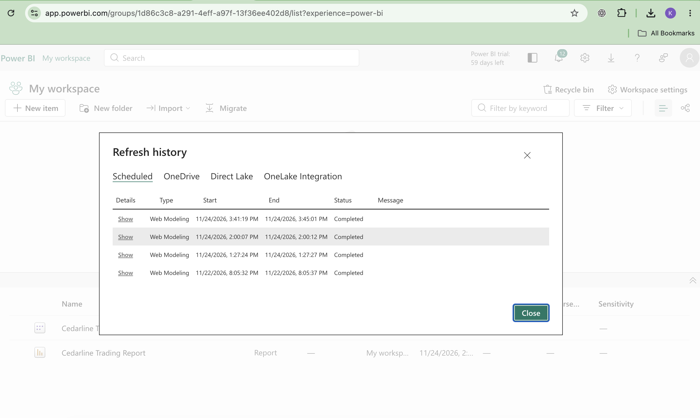

### Daily schedule

1. In n8n, set the workflow time zone to `Asia/Beirut`. The **Schedule Trigger** is set to **5:00 PM** daily and starts all three export branches. Publish the workflow after completing the local setup and manual test. Docker and OneDrive run on the Mac, which needs to be awake for the export and file sync. [n8n Schedule Trigger](https://docs.n8n.io/integrations/builtin/core-nodes/n8n-nodes-base.scheduletrigger/)
2. In the Power BI service, open **Cedarline Trading Model → Settings → Refresh**. Turn on the refresh schedule and set it to **Daily at 5:30 PM** in the **Beirut** time zone. The gap gives the CSVs time to sync before Power BI reads them. The model owner receives refresh failure notifications. [Power BI scheduled refresh](https://learn.microsoft.com/en-us/power-bi/connect-data/refresh-scheduled-refresh)
3. Check the daily cycle in **Executions** in n8n, the three file timestamps in OneDrive, and **Refresh history** in Power BI. [Power BI refresh history](https://learn.microsoft.com/en-us/power-bi/connect-data/refresh-data#checking-refresh-status-and-history)

The model uses a Web cloud connection signed in with the same work or school account as Power BI. When its preliminary credential test failed, saving with **Skip test connection** enabled allowed the OAuth 2.0 settings to save. A successful **Refresh now** run verified the saved connection before scheduling. [Microsoft’s connection test guide](https://community.fabric.microsoft.com/blog/fbc_pbiupdatesblog/skip-test-connection-for-on-premises-and-cloud-data-sources/5173999)

## Author

**Karim Khalil • B.S. Computer Science, Lebanese American University (November 2026) • ** · [GitHub](https://github.com/karimk223)
